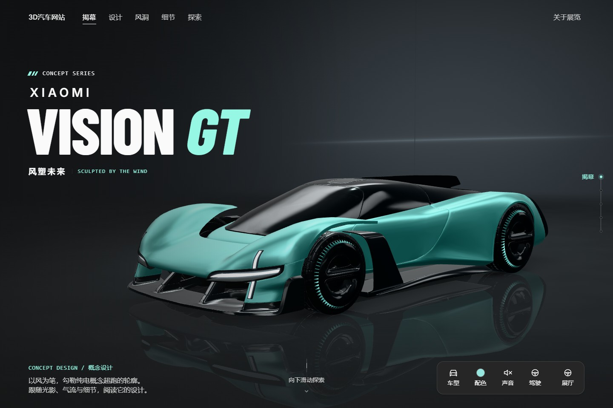
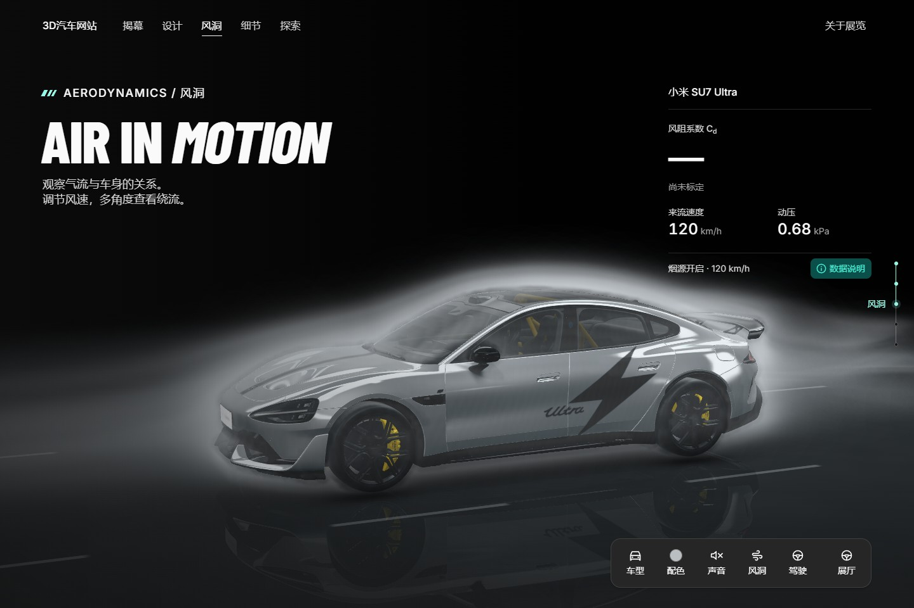
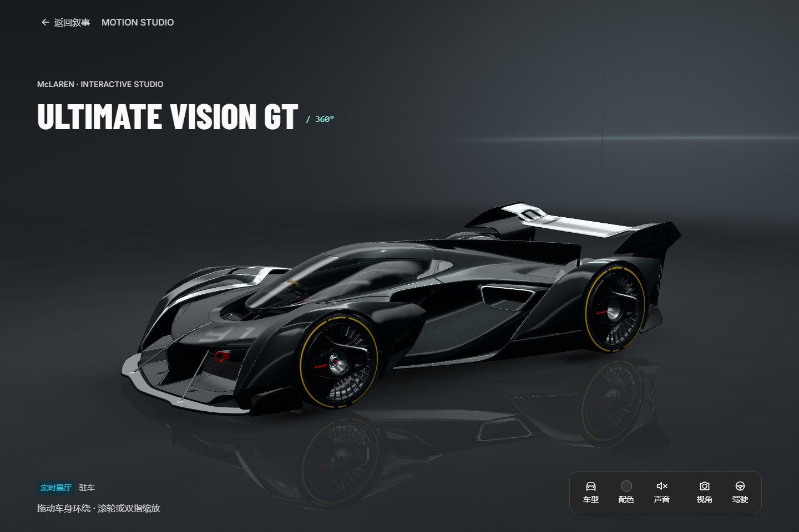

# 3D Car Web

[简体中文](README.md) | English

An interactive 3D car showcase with multiple vehicles, paint customization, driving demonstrations, and wind tunnel visualization.

## Preview



| Wind tunnel · Xiaomi SU7 Ultra | Interactive showroom · McLaren Ultimate Vision GT |
| :---: | :---: |
|  |  |

## Features

- **Vehicle showcase**: Switch vehicles, orbit freely, zoom, and select preset views.
- **Interactive controls**: Change paint colors and explore driving, doors, and cockpit views.
- **Wind tunnel visualization**: Adjust wind speed and observe airflow around the vehicle.
- **Adaptive presentation**: Desktop and mobile layouts with static image fallback.

Feature availability varies by vehicle. Door and cockpit interactions currently support Xiaomi Vision GT only. The wind tunnel is a visualization; Cd values are estimates or remain uncalibrated.

## Getting Started

Requires Node.js 22.12+ or 24 LTS.

```sh
git clone https://github.com/wwnetboy/3d-car-web.git
cd 3d-car-web
npm ci
npm run dev
```

Open [http://127.0.0.1:5173](http://127.0.0.1:5173).

```sh
npm run build    # Production build
npm run preview  # Local preview
```

Build output is written to `showroom/dist`.

## Development

Built with Three.js · React · TypeScript · Vite.

Vehicle definitions are in `showroom/src/vehicles.ts`, original models in `models/`, and web assets in `showroom/public/`.

[Model preparation](showroom/tools/model/README.md) · [Airflow methods](showroom/tools/model/cfd/README.md) · [Deployment and packaging](showroom/tools/deploy/README.md) — technical guides are currently in Chinese.

## Assets and Licenses

| Model | Author and source | License |
| --- | --- | --- |
| Xiaomi Vision GT | [hartwelkisaka](https://sketchfab.com/3d-models/xiaomi-vision-gt-a464599492e94e508b999b4775141727) | [CC BY 4.0](https://creativecommons.org/licenses/by/4.0/) |
| Xiaomi SU7 Ultra | [Ddiaz Design](https://sketchfab.com/3d-models/2025-xiaomi-su7-ultra-production-version-9d0a0a9285cb4ca59ccb9322ddf58d24) | [CC BY-NC-SA 4.0](https://creativecommons.org/licenses/by-nc-sa/4.0/) |
| McLaren Ultimate Vision GT | [VTX](https://sketchfab.com/3d-models/mclaren-ultimate-vision-gt-ffaaeb3b72ac4f12a35a4753bd9cc51b) | [CC BY-NC-SA 4.0](https://creativecommons.org/licenses/by-nc-sa/4.0/) |

Web models have been compressed, simplified, or split into components. Original attribution is retained; use is subject to each model's license.
