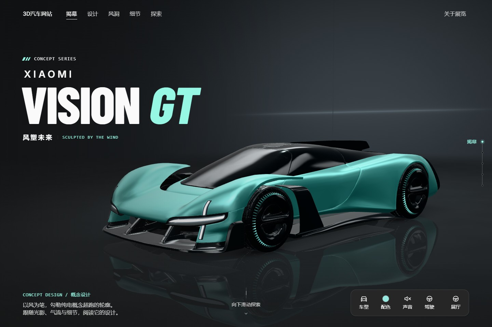
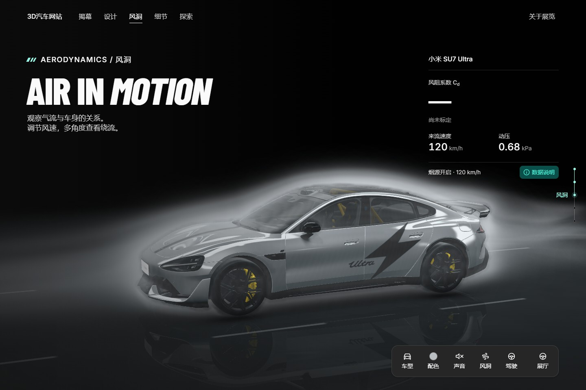
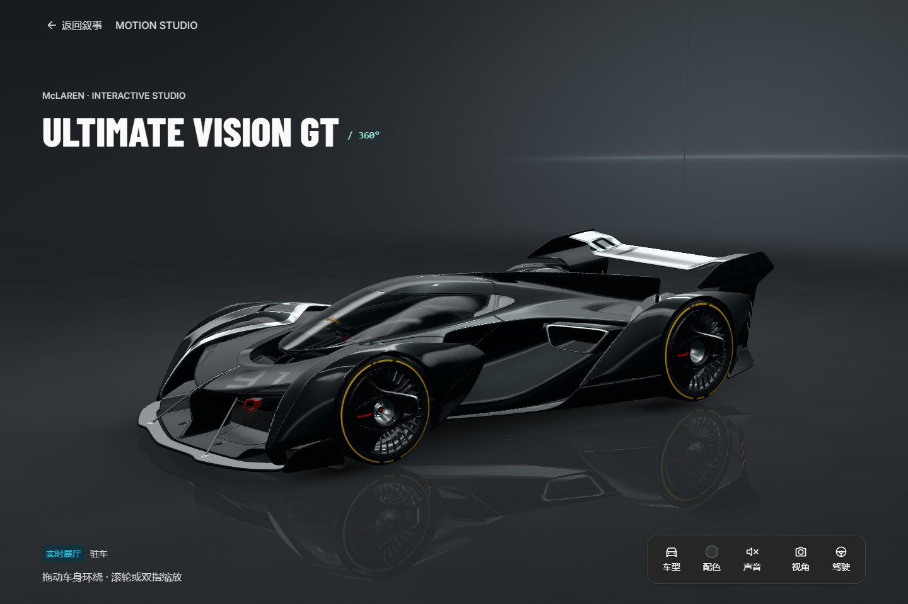

# 3D Car Web

简体中文 | [English](README.en.md)

交互式 3D 汽车展示网站，支持多车型浏览、外观配色、行驶演示与风洞可视化。

## 演示效果



| 风洞可视化 · Xiaomi SU7 Ultra | 交互展厅 · McLaren Ultimate Vision GT |
| :---: | :---: |
|  |  |

## 功能

- **车型展示**：切换车型，自由环绕、缩放或使用预设机位。
- **交互体验**：切换车身配色，体验行驶、车门与驾驶席交互。
- **风洞可视化**：调节风速，观察车身周围的气流演示。
- **自适应展示**：适配桌面与移动设备，支持静态影像回退。

功能按车型适配，车门与驾驶席目前仅支持 Xiaomi Vision GT。风洞用于可视化展示，Cd 为估算或尚未标定。

## 快速开始

需要 Node.js 22.12+ 或 24 LTS。

```sh
git clone https://github.com/wwnetboy/3d-car-web.git
cd 3d-car-web
npm ci
npm run dev
```

访问 [http://127.0.0.1:5173](http://127.0.0.1:5173)。

```sh
npm run build    # 生产构建
npm run preview  # 本地预览
```

构建产物位于 `showroom/dist`。

## 开发

技术栈：Three.js · React · TypeScript · Vite

车型配置位于 `showroom/src/vehicles.ts`，原始模型位于 `models/`，网页资源位于 `showroom/public/`。

[模型制备](showroom/tools/model/README.md) · [风洞方法](showroom/tools/model/cfd/README.md) · [部署与打包](showroom/tools/deploy/README.md)

## 资产与许可

| 模型 | 作者与来源 | 许可 |
| --- | --- | --- |
| Xiaomi Vision GT | [hartwelkisaka](https://sketchfab.com/3d-models/xiaomi-vision-gt-a464599492e94e508b999b4775141727) | [CC BY 4.0](https://creativecommons.org/licenses/by/4.0/) |
| Xiaomi SU7 Ultra | [Ddiaz Design](https://sketchfab.com/3d-models/2025-xiaomi-su7-ultra-production-version-9d0a0a9285cb4ca59ccb9322ddf58d24) | [CC BY-NC-SA 4.0](https://creativecommons.org/licenses/by-nc-sa/4.0/) |
| McLaren Ultimate Vision GT | [VTX](https://sketchfab.com/3d-models/mclaren-ultimate-vision-gt-ffaaeb3b72ac4f12a35a4753bd9cc51b) | [CC BY-NC-SA 4.0](https://creativecommons.org/licenses/by-nc-sa/4.0/) |

网页模型经过压缩、减面或部件拆分，保留原始署名，使用时须遵守对应许可。
