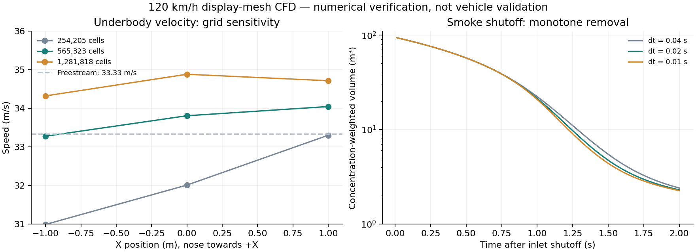

# 风洞 CFD 制备与核验

网页使用通过检查的 **565,323 单元中等网格** 的黏性流动与被动标量输运结果。实时页面只解码和渲染，不在浏览器中重新求解汽车空气动力学；1–300 km/h 控件改变该参考场的播放时标。Cd 仍由独立、明确标注的展示估算给出。

本次计算的参考工况是 **120 km/h**，空气运动黏度 `1.5e-5 m²/s`，密度 `1.225 kg/m³`。求解器是 OpenCFD OpenFOAM v2506 Windows MinGW 发行包，`simpleFoam`、SIMPLE、k–ω SST，入口湍流强度 1%。地面沿 −X 以 33.333 m/s 移动，轮组按 `ω = U/R` 旋转，车身和外轮罩静止。黏性壁面使用壁函数。

## 几何和网格

`geometry.mjs` 保留 GLB 世界坐标，以车身和四个旋转轮组导出表面。外轮罩归入静止车身。展示模型不是工程 CAD：原表面不水密，座舱依据玻璃与内饰凸包补封。`proxy.py` 以 20 mm 体素生成水密代理，不通过整体凸包封堵外侧通道。封闭体积、绕序、面数、模型指纹均写入几何审计。

计算域为 `x ∈ [-24,12] m`、`y ∈ [0,8] m`、`z ∈ [-8,8] m`，使用分级笛卡尔网格，在车身、底盘和尾流局部加密。最初贴体网格出现劣质单元及发散，未用于页面。最终采用未贴体的分级网格；无法形成三维梯度模板的窄缝单元按质量检查清单移出流体域，清单保留在 `pruned-stencils.json`。这代表未解析的缝隙，不能声称所有真实细缝都被准确计算。

| 网格 | 流体单元 | 入口/出口通量相对不平衡 | 底盘三处速度 m/s |
| --- | ---: | ---: | --- |
| 粗 | 254,205 | 1.80e-8 | 见核验数据 |
| 中 | 565,323 | 1.98e-8 | 34.05 / 33.81 / 33.28 |
| 细 | 1,281,818 | 9.90e-9 | 34.72 / 34.88 / 34.32 |

中、细网格在这三处的最大速度差约 **3.08%**。狭缝内低速回流与尾流中心更敏感。假设参考面积 2.5 m² 得到的阻力系数约为 0.599、0.582、0.553，最后两档仍相差 **5.27%**，没有证明网格无关性。部分壁面 y+ 偏大，没有边界层棱柱层，未做计算域独立性或实车数据对照。SIMPLE 的严格全场残差目标也未全部达到。**这些结果支持定性烟流展示，不支持工程 Cd 预测或精确压力读数；不报告 GCI 或“已通过空气动力学验证”。**

细网格的稳态标量解在局部慢交换区域出现最大约 17.54 的非物理浓度，虽然全局面通量误差很小、线性残差也已降低，仍然违反入口浓度上限。该结果被导出门禁拒绝，未写入网页。可能与极慢交换单元中的残余局部连续性误差和病态稳态系统有关，不能仅靠残差认定有效。发布的中等网格体积场浓度最大约 0.949，网页采样最大约 0.845；不通过裁剪失效的细网格数据制造通过结果。

## 烟雾与页面

`transport.py` 在固定的 RANS 速度和面通量上求解烟雾浓度、平均流体年龄以及入口坐标。只有入口注入烟雾，车身和缝隙不是烟源；有效扩散系数为 `ν/0.7 + νt/0.7`。这些正定扩散输运方程保留真正的慢流与回流，不再强制气流单向穿过每个 X 截面。坐标 Z 使用正值归一化，避免对称正负源导致迭代器数值退化。

渲染文件使用 v4 格式：64 字节头部，每体素 8 字节 RGBA16F 流动信息（行程时间、入口 Y/Z、车身距离），再跟随 2 字节浓度和相对湍流强度。网格为 256 × 96 × 128。`trace-texture.py` 在已有 CFD 速度上使用 RK2 反向追踪材质坐标，避免扩散后的平均坐标抹平烟纹转向；没有到达入口的闭合或慢速路径沿用平均坐标，不强迫其穿流。入口坐标升级为半精度，减少原来 8 位标签的条纹量化。车身内部仅外推材质坐标，浓度仍为零。

32 mm 与 16 mm 追踪步长作过对照：匹配区域的入口标签差异在第 95 百分位小于 0.44 mm，路径完成状态一致率约 99.855%。这只检查可视化追踪的步长敏感性，不改变前述 CFD 验证范围。v4 的浓度、湍流通道与已接受 v3 数据逐字节一致，不向浓度数据添加贴面烟源。

画面采用连续、具有纵向相关性的宽烟纹。入口截面轮廓固定在材质标签上，流动细节只作有界的小幅调制，避免大尺度移动噪声经平方放大后让整片烟幕忽浓忽淡。入口标签上的显示遮罩突出迎风区域，低速凹腔降低纹理对比；这是提高可读性的显示传递函数，不代表重新求解了另一套入口浓度。车身遮挡仍使用真实模型深度。车尾浓度使用下述局部瞬态记录，接入区域内退出原有正弦波纹；细小烟纹和贴面增厚仍是显示近似。默认恢复侧前方低角度视角，支持拖动查看顶面及两侧。

为恢复 15:33 版本的贴附观感，渲染层另有两项有界的光学增强：沿车壳距离以 18 cm 尺度衰减的软烟层，以及风道内和出口附近稍厚的烟层。`contact.bin` v2 的 32 字节头部后是 RGBA8：R/G 为同一 GLB 的风道及约束标记，B 为直接体素化车模的保守表面距离，A 保留。头部末尾保存距离的偏移与缩放。它不提供速度或 CFD 浓度；烟雾和增强标记同时受 CFD 固体与展示模型边界约束，避免采样流体网格漏掉薄玻璃和薄板。相机深度仍在精确可见表面截断积分。增强权重最高为 1，离风道表面 0.5 m 后退出，仍乘以原浓度和同一到达/关烟门控；不恢复旧版高强度的 `7.5 × 通道标记` 加法。背景烟适当变淡以突出这一层，不将增强后的亮度解释为压力或实际烟雾浓度。

显示标记使用 `node tools/model/prepare-contact.mjs .artifacts/duct-flow` 生成；若需重建来源，可先运行 `node tools/model/flow.mjs .artifacts/duct-flow`。模型指纹与来源文件指纹记录在 `public/flow/contact-audit.json`。网页加载时同时核对维度、格式、长度与距离编码，原始与压缩版本均保留。`node tools/model/verify-contact.mjs` 检查两档车模的每个三角形重心及三个偏心点，共 2,300,480 个探针，修正后的表面无烟检查全部通过；这属于渲染碰撞覆盖验证，不代表 CFD 网格已解析这些薄壁。

关闭「喷烟」停止入口并让已有烟雾按行程时间向后清空，地面与车轮继续按风速工作。网页的清空动画使用追踪时间，闭合或慢速区域使用平均年龄近似；独立的离线关烟测试才使用时间相关的输运方程。减少动态效果模式直接切换定帧。

## 车尾局部瞬态计算

`transient.py` 从已接受的整车平均速度、面通量及正定浓度初始化；`subset-wake.py` 保留后车身、部分后轮和移动地面，生成 **126,768 单元**的局部计算域：`x=[-9.24,-1.68]`、`y=[0,2.087]`、`z=[-2.311,2.311] m`。截面采用整车平均流场的速度及湍流、烟雾剖面，没有加入周期性摆动入口。它不能替代整车瞬态载荷计算。

使用 [OpenFOAM pimpleFoam](https://www.openfoam.com/documentation/user-guide/a-reference/a.1-standard-solvers) 的非定常不可压缩 PIMPLE、k–ω SST URANS，参考速度仍为 120 km/h。每步两次外迭代、每次一次压力修正，最大 Courant 数 0.8。速度用 backward，标量用 Euler、迎风对流、隐式正交扩散。局部网格最大非正交角约 25.87°；正交扩散是数值近似，没有据此宣称空间收敛或 LES 涡尺度解析能力。

最初局部试算出现负浓度，改用隐式正交扩散后，延长计算仍出现浓度超过初始上限。定位到截面上有流出/回流的面却使用固定标量值；最终烟雾、k、ω 在截面使用 [inletOutlet](https://doc.openfoam.com/2312/tools/processing/boundary-conditions/rtm/derived/inletOutlet/inletOutlet/)，只在流入时指定前驱剖面，流出时使用零梯度。这两批失效烟雾均被拒绝，未裁剪后发布。被动标量不反馈速度，因此仅保留经有限值检查的流动预热状态，烟雾从原始有界平均场重新初始化。

`transient-audit.py` 检查整个计算历程的浓度最大值原理、有限值、时间步、Courant 数、局部/整体连续性及各开放边界总通量。`compare-transient.py` 对相同初值与边界、最大 Courant 数 0.8/0.4 的两组运行比较 100 个尾流探针；0.05–0.24 s 区间速度 RMS 差约 0.01158 m/s（入口速度的 0.0347%），浓度 RMS 差约 0.00007572、最大差约 0.0004809，均通过预先设定的门限。这是有限时段的时间步敏感性检查，不是网格无关性或实验校准。

最终主计算完成至 0.90024 s，共 1,868 步，无湍流量负值修正事件；全程浓度范围约 `[0.00733425, 0.74526262]`，不超过初始/入口上限 `0.74531723`。开放边界总通量最大相对不平衡约 `1.165e-9`。记录取 0.4–0.90024 s 的 **26 帧**，没有放大原始变化量。

`export-wake.py` 只接受已完成且检查通过的案例，输出候选 `wake.bin` 和审计。64 字节头部记录版本、尺寸、范围、参考风速及接续时长；其后为各帧相对时间和逐帧 R16F 浓度，采样网格为 **64 × 32 × 48**，范围 `[-5.4,.025,-2.15]` 至 `[-2.3,2.05,2.15] m`。无流体采样的实体体素为零，有限值和上下界在半精度编码前后均检查。当前文件原始约 5.11 MB、gzip 约 3.41 MB。

浏览器把四个相邻时刻打包为一个 RGBA16F 体纹理，以非负、和为 1 的权重插值；有限记录的首尾用平滑交叠接续，避免硬切。原始记录不是周期解，接续属于播放近似。车后浓度渐变接入，车身、玻璃的几何距离与深度检查始终在原始世界坐标执行，没有波浪位置扭曲。其他速度仅缩放这个参考记录的时标。

这一网格、平均入口和 URANS 模型得到的尾流变化较小；短记录也包含残余稳定过程。**不把它放大成可见大浪，不据此报告真实脱涡频率或风洞测得的振幅。** 细小烟纹沿平均流场平流，仍是渲染细节。更准确的真实非定常涡需要工程几何、相应的网格/边界层与足够长的 LES/DES 计算，以及实测对照。

现有运行的复查命令（在 `showroom` 下）：

```powershell
python tools/model/cfd/transient-audit.py .artifacts/cfd/wake-open --startup .4
python tools/model/cfd/transient-audit.py .artifacts/cfd/wake-open-half --startup .05
python tools/model/cfd/compare-transient.py .artifacts/cfd/wake-open .artifacts/cfd/wake-open-half --start .05 --end .24
python tools/model/cfd/export-wake.py .artifacts/cfd/wake-open .artifacts/cfd/wake-playback --start .4
node tools/model/verify-wake.mjs .artifacts/cfd/wake-playback
```

重建时先用 `transient.py` 建整车前驱与独立候选目录，再在分解并行网格前运行 `subset-wake.py`；通过 `record-wake.py` 设置采样，`foam.ps1` 运行 `decomposePar`、`pimpleFoam` 和 `reconstructPar`。`restart-wake.py` 从预热检查点建立独立的主计算/半时间步对照，记录初值指纹并拒绝复制失效烟雾。最终来源、时间、范围、数值门禁及记录变化量保存在 `public/flow/wake-audit.json`。

## 已执行的验证

- 三档 Couette 移动壁面基准，与解析线性速度剖面的最大误差约 `4.61e-9 m/s`。
- 四档标量空间网格和三档时间步：周期域质量误差约 `1e-11`；空间误差随细化下降，最细一对的阶数约 0.916，时间方差误差阶数约 1.000。
- 汽车的逐单元面通量、入口/出口守恒；几何和二进制文件指纹；浓度有限且有界；实体区域无烟源。
- 中等网格关烟 2 秒，`dt = 0.04 / 0.02 / 0.01 s` 三组均单调减烟；末态浓度体积积分分别为 2.406 / 2.298 / 2.257，最后两档相差约 1.83%。起始为稳态浓度，极慢交换的凹腔仍可能保留少量烟雾。该车的时间步研究未被当作严格渐近收敛证明。
- 浏览器检查入口、车头缝隙、底盘、车尾、俯视、风速、关烟、拖动与移动端；构建通过。机器上的帧率不是手机性能承诺。

可复查数据保存在项目内 `.artifacts/cfd/verification.json`；公开的精简审计随 `public/flow/audit.json` 和 `verification.json` 发布。数值验证与实验验证是两件事。



## 复现

以下命令从 `showroom` 目录运行。直接启动或构建网页无需安装 CFD 工具，也无需重新计算。

```powershell
./tools/model/cfd/setup.ps1
node tools/model/cfd/geometry.mjs
python tools/model/cfd/proxy.py
python tools/model/cfd/benchmarks.py

python tools/model/cfd/case.py medium --cell .36
./tools/model/cfd/mesh.ps1 -Case .artifacts/cfd/medium
./tools/model/cfd/foam.ps1 -Tool decomposePar -ToolArgs @('-case','.artifacts/cfd/medium')
./tools/model/cfd/foam.ps1 -Tool simpleFoam -Ranks 8 -ToolArgs @('-case','.artifacts/cfd/medium')
./tools/model/cfd/foam.ps1 -Tool reconstructPar -ToolArgs @('-case','.artifacts/cfd/medium','-latestTime')

python tools/model/cfd/transport.py .artifacts/cfd/medium .artifacts/cfd/smoke
./tools/model/cfd/solve-transport.ps1 -Case .artifacts/cfd/smoke -Output .artifacts/cfd/candidate
python tools/model/cfd/washout.py .artifacts/cfd/smoke

# 独立的可视化追踪依赖，不覆盖 CFD 的 NumPy 环境。
python -m pip install --target .artifacts/trace-python -r tools/model/cfd/trace-requirements.txt
python tools/model/cfd/trace-texture.py --source .artifacts/cfd/candidate --output .artifacts/cfd/traced
node tools/model/cfd/verify-field.mjs .artifacts/cfd/traced .artifacts/cfd/candidate
```

粗、细网格的基础单元参数分别为 `.48`、`.27`。质量检查或求解失败会停止输出流程；禁止把初始化的空烟场当成计算结果。所有运行时、Python 依赖、几何代理、网格、完整求解输出和失败实验均位于忽略的 `.artifacts` 下；不修改系统 PATH、不启用 WSL，也不安装系统服务。首次配置需一个可用的完整 `7z.exe`，可传入 `-SevenZip` 指定路径。

候选数据经过数值与画面检查后才复制到 `public/flow`；同时更新缓存版本和风洞静态影像。旧势流工具仍保留作对照，不应用于覆盖 CFD 数据。

依据：[OpenFOAM 被动标量输运](https://api.openfoam.com/2506/classFoam_1_1functionObjects_1_1scalarTransport.html)、[NASA 网格收敛说明](https://www.grc.nasa.gov/www/wind/valid/tutorial/spatconv.html)、[移动地面与旋转车轮研究](https://saemobilus.sae.org/articles/effects-moving-ground-rotating-wheels-aerodynamic-drag-a-two-box-vehicle-2018-01-0730)、[NASA 烟流可视化](https://www.grc.nasa.gov/www/K-12/airplane/tunvsmoke.html)。
